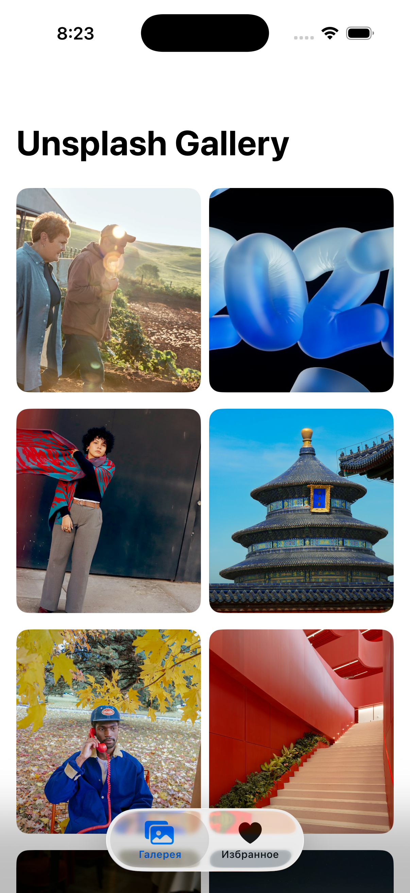
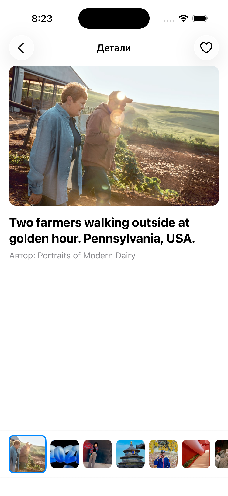
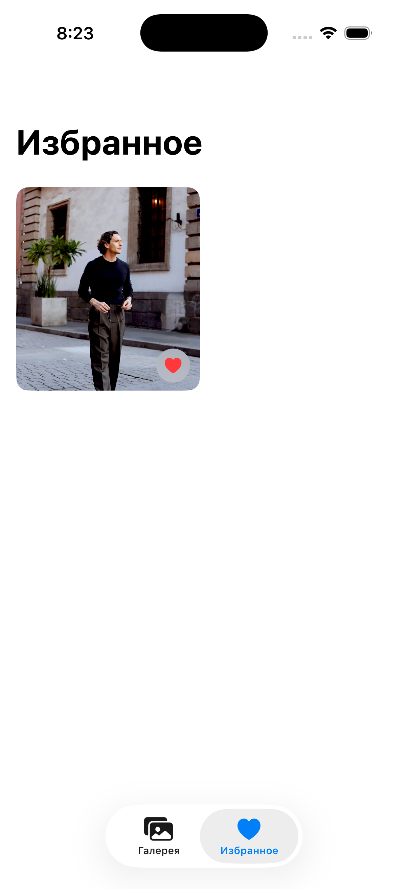

# Gallery App (iOS Intern Task) 🖼️

A beautifully designed iOS application that allows users to browse a curated list of high-quality photos, view detailed information, and save their favorite images locally.

**Developer:** Povedayko Nikita
**Contact / Profile:** Telegram: @n_nicky, GitHub: https://github.com/as7r4l

---

## 📖 Project Overview

This project was developed as a test task for an iOS Developer Internship. It demonstrates proficiency in modern iOS development, including UI design, asynchronous data retrieval, native persistence, and clean architectural patterns. 

Targeting **iOS 17+**, the app leverages the latest Apple technologies to provide a smooth, native user experience.

### ✨ Key & Unique Features (Beyond Requirements)
While fulfilling all the core requirements, I implemented several additional features to enhance the User Experience (UX):
*   **Native-like Thumbnail Scrubber:** The detail view includes a dynamic horizontal thumbnail scroller (similar to the default iOS Photos app). The active thumbnail automatically scales up, providing excellent spatial context.
*   **Seamless Tab Bar Management:** Built a robust navigation flow using `NavigationStack` where the Tab Bar automatically hides when entering detail views and elegantly reappears upon return.
*   **Dependency Injection & Testability:** Designed the network layer using protocols (`NetworkServiceProtocol`), allowing for seamless unit testing with mock data.

---

## 🛠 Architecture & Technologies

The project is built with strict adherence to **SOLID principles** and modularity:

*   **Architecture Pattern:** **MVVM** (Model-View-ViewModel). Ensures a clean separation of concerns between the UI state and business logic.
*   **UI Framework:** **SwiftUI**. Chosen over UIKit to leverage modern declarative syntax, as the project targets iOS 17+. SwiftUI provides superior state management and animation capabilities for features like the thumbnail scrubber.
*   **Data Persistence:** **Core Data**. Used native Core Data with a `Singleton` pattern (`CoreDataManager`) for reliable, thread-safe local storage of favorite photos.
*   **Networking:** Native `URLSession` combined with modern Swift Concurrency (**async/await**). 
*   **Image Caching:** Used native `AsyncImage` for efficient, out-of-the-box asynchronous image loading and caching.

---

## 📸 Screenshots

*(Replace these placeholder links with actual screenshots of your app)*

| Gallery Screen | Image Detail (with Scrubber) | Favorites Screen |
| :---: | :---: | :---: |
|  |  |  |

---

## ⚙️ Configuration & Setup

1. **Clone the repository:**
   ```bash
   git clone [Your GitHub Repository URL]
   ```
2. **Open the project:**
   Open `GalleryApp.xcodeproj` in Xcode 15 or later.
3. **API Key (Unsplash):**
   The project uses the Unsplash API. A valid API access key is already included in the `NetworkService.swift` file for testing convenience. If you hit the rate limit (50 requests/hour), you may replace the `accessKey` property in `NetworkService` with your own key from [Unsplash Developers](https://unsplash.com/developers).
4. **Build & Run:** Select a simulator (iOS 17.0+) and press `Cmd + R`.

---

## 🧪 Testing

The project includes Unit Tests to demonstrate testability and code quality. 
*   **`GalleryViewModelTests`**: Verifies the business logic of pagination and data fetching using a `MockNetworkService` (Dependency Inversion Principle).
*   To run the tests, press `Cmd + U` in Xcode.

---

## 🌿 Git Workflow
This project was developed strictly using **Gitflow**. 
*   Features were developed in isolated branches (e.g., `feature/favorites-screen`, `feature/unit-tests`).
*   **Conventional Commits** were used to maintain a structured and human-readable commit history (e.g., `[ADDED]`, `[FIXED]`, `[REFACTORED]`).
